<p align="center">
  
</p>

<p align="center">
  <a href="https://github.com/ishandutta2007/Awesome-Awesome-Awesome"></a>
  <a href="https://discord.gg/jc4xtF58Ve"></a>
  <a href="https://github.com/ishandutta2007/Awesome-Vector-Database/stargazers"></a>
  <a href="https://github.com/ishandutta2007/Awesome-Vector-Database/network/members"></a>
  <a href="https://github.com/ishandutta2007/Awesome-Vector-Database/pulls"></a>
  <a href="https://github.com/ishandutta2007/Awesome-Vector-Database/blob/main/LICENSE"></a>
  <a href="https://github.com/ishandutta2007"></a>
</p>

---

# ⚡ Awesome Vector Database & AI Retrieval Ecosystem 🚀

Welcome to the definitive, community-curated index of **Vector Databases**, **Approximate Nearest Neighbor (ANN) Search Engines**, **Embedding Stores**, and **RAG (Retrieval-Augmented Generation) Infrastructure**. 

Whether you are scaling high-throughput semantic search, architecting an enterprise agentic memory system, indexing multimodal embeddings, or looking for lightweight embedded vector engines, this list covers both battle-tested **SaaS / Managed DBaaS platforms** and high-performance **Open-Source GitHub projects**.

> 💡 **Keywords**: *Vector Database, Vector Search Engine, Embeddings, Semantic Search, Approximate Nearest Neighbor (ANN), HNSW, RAG Backends, Milvus, Qdrant, Chroma, Weaviate, Pinecone, pgvector, Faiss, Multimodal Retrieval, LLM Memory.*

---

## 📑 Table of Contents

- [📊 Sector Overview & Market Dynamics](#-sector-overview--market-dynamics)
- [☁️ SaaS & Managed Vector Platforms](#️-saas--managed-vector-platforms)
- [⚡ Open-Source Vector Databases & Libraries](#-open-source-vector-databases--libraries)
  - [🏆 Top Open-Source Vector Engines (Ranked by Stars)](#-top-open-source-vector-engines-ranked-by-stars)
  - [🧩 Architectural Comparison & Selection Matrix](#-architectural-comparison--selection-matrix)
- [🛠️ How to Choose the Right Vector Store](#️-how-to-choose-the-right-vector-store)
- [🤝 How to Contribute](#-how-to-contribute)
- [📈 Star History](#-star-history)
- [💖 Support & Community](#-support--community)
- [⚠️ Disclaimer](#️-disclaimer)

---

## 📊 Sector Overview & Market Dynamics

The global vector database and neural search market is valued at approximately **$2.5B to $3.2B in 2025–2026**, on track to expand at a CAGR of **22% to 27%** to reach **$7.3B to $18B by the early 2030s**, accelerated by the enterprise transition from experimental RAG text chatbots to production-grade **Agentic AI** requiring low-latency, persistent semantic memory.

The competitive landscape is **moderately to highly fragmented** rather than winner-take-all:
- **Purpose-Built Vector Databases** (*Pinecone, Qdrant, Milvus, Weaviate, Chroma*) continue to dominate developer mindshare and provide tailored indexing, payload filtering, and extreme ANN throughput.
- **Relational & General-Purpose Database Giants** (*PostgreSQL via pgvector, Elasticsearch, Redis, MongoDB Atlas, Cassandra/Astra DB*) are aggressively expanding native vector extensions, driving an ongoing *"purpose-built engine vs. database feature"* debate across enterprise engineering teams.

---

## ☁️ SaaS & Managed Vector Platforms

The table below outlines leading hosted Vector Database-as-a-Service (DBaaS) providers, sorted in descending order by **Company Size (Estimated Valuation / ARR)**. Every entry specifies transparent starting tier pricing and exact free tier/trial limits.

| 🏢 Platform | 💰 Valuation / Company Size | 🏷️ Starting Pricing (Specific) | 🎁 Free Tier / Trial Limits (Specific) | 🚀 Core Capabilities & Focus |
| :--- | :--- | :--- | :--- | :--- |
| **[Elastic Cloud](https://www.elastic.co/)** | **~$6.0B Valuation**<br>*(Public: ESTC • >$1.0B ARR)* | **$95.00/month**<br>*(Standard Tier, approx. $0.132/hr)* | **14-day free trial**<br>*(Up to 2 nodes, 8 GB RAM, full vector & BM25 search capabilities, no CC required)* | Enterprise search AI platform pairing traditional inverted BM25 search with native HNSW dense/sparse vector search and ELK analytics. |
| **[Redis Cloud](https://redis.io/cloud/)** | **~$2.0B Valuation**<br>*(Series G • ~$300M+ ARR)* | **$7.00/month**<br>*(Fixed 250 MB Pro Plan with vector search)* | **Free forever plan**<br>*(1 database, 30 MB memory storage, vector similarity search enabled, 30 concurrent connections)* | In-memory ultra-low-latency vector search engine tailored for LLM prompt caching, session context, and real-time agent memory. |
| **[DataStax Astra DB](https://www.datastax.com/products/datastax-astra)** | **~$1.6B Valuation**<br>*(Series F • ~$245M+ Revenue)* | **$0.25 / 1M vector read ops**<br>*(+ $0.10/GB storage/month, Serverless Pay-As-You-Go)* | **Free forever tier**<br>*($25 monthly recurring credit ≈ 5M vector operations & ~40 GB vector storage perpetually free)* | Serverless vector database built natively on Apache Cassandra, engineered for massive global replication and high write throughput. |
| **[Pinecone](https://www.pinecone.io/)** | **~$750M Valuation**<br>*(Series B • ~$14M ARR)* | **$0.33/GB storage/month**<br>*(+ $0.00000825/read unit Serverless; Pods start at $0.096/pod-hour ≈ $70/mo)* | **Free forever Starter plan**<br>*(1 project, 1 index, up to 2 GB storage / ~100,000 vectors of 1536-dim, single region, no CC required)* | Pioneering fully managed serverless vector database with instant autoscaling, live metadata filtering, and turnkey RAG integrations. |
| **[Zilliz Cloud](https://zilliz.com/)** | **~$600M Valuation**<br>*(Series B • ~$16.2M Revenue)* | **$0.05/hour**<br>*(Approx. $36/month for Standard Serverless, or $0.0001 per 1k CU)* | **Free forever Starter tier**<br>*(2 collections, up to 1,000,000 vectors at 768-dim) + $100 free usage credit valid for 30 days* | Fully managed cloud edition of open-source Milvus, providing multi-tenant enterprise indexing, GPU acceleration, and billions-scale search. |
| **[Weaviate Cloud](https://weaviate.io/pricing)** | **~$200M Valuation**<br>*(Series B • ~$12.3M Revenue)* | **$0.025 / 10k dimensions/mo**<br>*(Standard Serverless tier, minimum billing ~$25/month)* | **14-day free Sandbox cluster**<br>*(Fully featured cluster holding up to 100,000 vectors, no credit card required)* | AI-native vector database offering hybrid dense/sparse vector search, GraphQL querying, multimodal embeddings, and modular vectorizers. |
| **[Qdrant Cloud](https://qdrant.tech/pricing/)** | **~$150M Valuation**<br>*(Series B • ~$9.2M ARR)* | **$0.034/hour**<br>*(Dedicated tier starts at ~$25/month for 0.5 vCPU, 1 GB RAM node)* | **Free forever tier**<br>*(1 permanent cluster, 1 GB RAM, 0.5 vCPU, up to ~200,000 vectors at 768-dim, no expiry)* | Rust-engineered high-throughput vector database featuring deep JSON payload filtering, scalar/product quantization, and disk-backed storage. |
| **[Chroma Cloud](https://www.trychroma.com/)** | **~$80M Valuation**<br>*(Seed/Series A • ~$3M Revenue)* | **$0.10/GB storage/month**<br>*(+ $0.001 per 1,000 queries on Serverless)* | **Free forever tier**<br>*(Up to 5 GB storage, 1M read/write operations per month, community support)* | Managed developer-centric embedding database focused on minimal setup overhead, native Python/JS bindings, and LLM prototyping. |
| **[Marqo Cloud](https://www.marqo.ai/pricing)** | **~$50M Valuation**<br>*(Series A • ~$19.4M Raised)* | **$0.21/hour**<br>*(Dedicated production index starting at approx. $150/month)* | **14-day free trial**<br>*($100 free trial credits, up to 100,000 multimodal vectors, image & text ML inference included)* | End-to-end multimodal vector search engine handling both vector generation and indexing without requiring external embedding pipelines. |
| **[Vespa Cloud](https://cloud.vespa.ai/)** | **Enterprise Spinout**<br>*(Yahoo origin • >$10M ARR)* | **$0.01/vCPU-hr + $0.0015/GB-hr**<br>*(Approx. $20/month minimum deployment footprint)* | **30-day free trial**<br>*($300 trial credits, supporting up to 1,000,000 documents with multi-stage ranking)* | Large-scale AI data engine combining vector search with ColBERT token-level scoring, lexical search, and real-time machine-learned ranking. |

---

## ⚡ Open-Source Vector Databases & Libraries

Open source remains the bedrock of vector retrieval and embedding infrastructure. The repositories below are sorted in descending order by **GitHub Star Count**, with live social badges linking straight to each repository's stargazers.

### 🏆 Top Open-Source Vector Engines (Ranked by Stars)

1. **[Meilisearch](https://github.com/meilisearch/meilisearch)** [](https://github.com/meilisearch/meilisearch/stargazers)  
   🦀 **Language**: Rust | 🔍 **Specialty**: Lightning-Fast Hybrid Search  
   An ultra-fast, open-source search engine providing delightful developer ergonomics, typo tolerance, and seamless hybrid search combining keyword and vector similarity queries.

2. **[Milvus](https://github.com/milvus-io/milvus)** [](https://github.com/milvus-io/milvus/stargazers)  
   🌐 **Language**: Go / C++ | 🏢 **Specialty**: Massive Distributed Scale  
   An open-source distributed vector database built from the ground up for massive-scale embedding retrieval, supporting multiple indexing strategies (HNSW, IVF, SCaNN) and multi-billion-vector datasets.

3. **[Faiss](https://github.com/facebookresearch/faiss)** [](https://github.com/facebookresearch/faiss/stargazers)  
   🔬 **Language**: C++ / Python | ⚡ **Specialty**: Core Algorithm Library & GPU Acceleration  
   Meta’s industry-standard library for efficient similarity search and clustering of dense vectors. Contains state-of-the-art GPU-accelerated indexes that power many production vector engines.

4. **[Qdrant](https://github.com/qdrant/qdrant)** [](https://github.com/qdrant/qdrant/stargazers)  
   🦀 **Language**: Rust | 🛡️ **Specialty**: Rich JSON Payload Filtering & Quantization  
   A high-performance vector search engine written in Rust. Features first-class support for extended payload filtering during nearest neighbor traversal and memory-efficient vector quantization (Scalar/Binary/PQ).

5. **[Chroma](https://github.com/chroma-core/chroma)** [](https://github.com/chroma-core/chroma/stargazers)  
   🐍 **Language**: Python / Rust | 🎯 **Specialty**: AI-Native Developer Ergonomics  
   The popular open-source embedding database purpose-built for LLM applications. Provides native collection management, automatic embedding generation, and seamless local or client-server setups.

6. **[Typesense](https://github.com/typesense/typesense)** [](https://github.com/typesense/typesense/stargazers)  
   ⚡ **Language**: C++ | 🔍 **Specialty**: In-Memory Typo-Tolerant Hybrid Search  
   An open-source, in-memory search engine offering out-of-the-box vector search alongside fast text search and auto-embedding generation using popular HuggingFace / OpenAI models.

7. **[pgvector](https://github.com/pgvector/pgvector)** [](https://github.com/pgvector/pgvector/stargazers)  
   🐘 **Language**: C | 🔗 **Specialty**: PostgreSQL-Native Vector Extension  
   The open-source vector similarity search extension for PostgreSQL. Enables storing vectors right alongside relational business tables, supporting exact L2/cosine distance as well as HNSW and IVFFlat index types.

8. **[Weaviate](https://github.com/weaviate/weaviate)** [](https://github.com/weaviate/weaviate/stargazers)  
   🌐 **Language**: Go | 🧠 **Specialty**: Modular Hybrid Search & Vectorizers  
   An open-source vector search engine and database supporting schema definition, hybrid dense/sparse keyword search (BM25), and plug-and-play modules for automated text, image, and audio vectorization.

9. **[txtai](https://github.com/neuml/txtai)** [](https://github.com/neuml/txtai/stargazers)  
   🐍 **Language**: Python | 🤖 **Specialty**: All-in-One Embeddings & LLM Pipelines  
   An all-in-one embeddings database that unifies vector search, document parsing, audio transcription, and LLM orchestration within an integrated open-source Python framework.

10. **[LanceDB](https://github.com/lancedb/lancedb)** [](https://github.com/lancedb/lancedb/stargazers)  
    📊 **Language**: Rust / Python | 💾 **Specialty**: Serverless Columnar Storage (Lance)  
    A modern, serverless embedded vector database built on top of the open-source Lance columnar data format, delivering fast disk-based ANN search and native multimodal support without in-memory bloat.

11. **[sqlite-vec](https://github.com/asg017/sqlite-vec)** [](https://github.com/asg017/sqlite-vec/stargazers)  
    🪶 **Language**: C | 📱 **Specialty**: Lightweight & Edge-Native Vector Search  
    A lightweight, no-dependency SQLite vector search extension written in pure C. Capable of running anywhere SQLite runs, including mobile devices, edge nodes, and web browsers via WASM.

12. **[Vespa](https://github.com/vespa-engine/vespa)** [](https://github.com/vespa-engine/vespa/stargazers)  
    🚀 **Language**: C++ / Java | 📈 **Specialty**: Billion-Scale Serving & Multi-Stage ML Ranking  
    An enterprise-grade open-source big data engine capable of serving vector search, lexical retrieval, and complex machine-learned ranking stages with sub-second latencies on enormous volumes of real-time data.

13. **[hnswlib](https://github.com/nmslib/hnswlib)** [](https://github.com/nmslib/hnswlib/stargazers)  
    ⚡ **Language**: C++ | 📐 **Specialty**: Header-Only Fast HNSW Algorithm  
    A header-only C++ library with clean Python bindings for fast approximate nearest neighbor search based on Hierarchical Navigable Small World graphs. Serves as the core algorithmic engine for numerous vector stores.

14. **[Marqo](https://github.com/marqo-ai/marqo)** [](https://github.com/marqo-ai/marqo/stargazers)  
    🖼️ **Language**: Python / C++ | 🎨 **Specialty**: Native Multimodal Text & Image Retrieval  
    An end-to-end open-source vector search engine that ingests raw text and image files, transforms them into embeddings via integrated inference models, and indexes them for high-accuracy search.

15. **[Vald](https://github.com/vdaas/vald)** [](https://github.com/vdaas/vald/stargazers)  
    ☸️ **Language**: Go | ☁️ **Specialty**: Cloud-Native Kubernetes Architecture  
    A highly scalable, distributed approximate nearest neighbor vector search engine architected specifically for Kubernetes environments, leveraging NGT for high-accuracy vector neighborhood indexing.

16. **[OpenSearch k-NN](https://github.com/opensearch-project/k-NN)** [](https://github.com/opensearch-project/k-NN/stargazers)  
    🔎 **Language**: Java / C++ | 🔌 **Specialty**: Search Engine Vector Plugin  
    The official k-nearest neighbors plugin for OpenSearch, enabling vector similarity search alongside traditional search indexes utilizing Faiss and NMSLIB backends.

---

### 🧩 Architectural Comparison & Selection Matrix

| Engine | Best Architectural Fit | Indexing Techniques | Deployment Mode |
| :--- | :--- | :--- | :--- |
| **pgvector** | Relational apps already running Postgres who want unified ACID transactions | HNSW, IVFFlat | In-Database Extension |
| **Qdrant** | High-concurrency production microservices requiring deep payload metadata filtering | HNSW, Scalar/Product Quantization | Standalone Daemon / Cloud |
| **Milvus** | Enterprise-scale distributed deployments indexing tens of millions to billions of vectors | HNSW, IVF_FLAT, SCaNN, GPU | Distributed Cluster / Cloud |
| **Chroma** | Rapid prototyping, local Python/JS development, and plug-and-play LLM applications | HNSW | Embedded / Client-Server |
| **LanceDB** | Disk-centric analytics, multimodal files (audio/video), and low-cost serverless indexing | Lance Columnar Disk Index | Serverless / Embedded |
| **Faiss** | Custom in-process algorithms, research pipelines, and extreme raw GPU vector clustering | Flat, IVFPQ, HNSW | In-Memory Library |
| **sqlite-vec** | Edge computing, mobile devices, local client apps, and browser-based WASM | Exact Flat, Inverted | Embedded Extension |

---

## 🛠️ How to Choose the Right Vector Store

```
                           ┌────────────────────────┐
                           │ Do you already have a  │
                           │ primary database?      │
                           └──────────┬─────────────┘
                                      │
                     ┌────────────────┴────────────────┐
                     ▼ YES                             ▼ NO
       ┌───────────────────────────┐      ┌───────────────────────────┐
       │ Is it PostgreSQL?         │      │ What is your primary      │
       └─────────────┬─────────────┘      │ engineering priority?     │
                     │                    └─────────────┬─────────────┘
          ┌──────────┴──────────┐                       │
          ▼ YES                 ▼ NO                    ├──────────────────────────────┐
  ┌───────────────┐     ┌───────────────┐               ▼                              ▼
  │ Use pgvector  │     │ Use dedicated │     ┌───────────────────┐          ┌───────────────────┐
  │ Keep data &   │     │ vector store  │     │ Ultra-Low Ops /   │          │ Maximum Scale /   │
  │ vectors in    │     │ or native DB  │     │ Developer Speed   │          │ Complex Filtering │
  │ one place     │     │ vector plugin │     └─────────┬─────────┘          └─────────┬─────────┘
  └───────────────┘     └───────────────┘               │                              │
                                                        ▼                              ▼
                                                ┌───────────────┐              ┌───────────────┐
                                                │ Chroma /      │              │ Qdrant /      │
                                                │ Pinecone /    │              │ Milvus /      │
                                                │ LanceDB       │              │ Weaviate      │
                                                └───────────────┘              └───────────────┘
```

---

## 🤝 How to Contribute

Contributions are warmly welcomed! Help keep this ecosystem guide up-to-date:

1. **Fork this repository** to your own GitHub account.
2. **Add or update an entry** in `README.md` following the existing format.
3. Include: Product name, official link, 1–2 sentence description, and whether it's SaaS/hosted or open-source.
4. If adding a SaaS product, include specific starting tier pricing and specific free tier limits.
5. If adding an open-source project, include its star badge (`style=social&color=white`) linking to its stargazers page.
6. **Submit a Pull Request** with a brief summary of what was added or changed.

---

## 📈 Star History

[](https://star-history.dera.page/#ishandutta2007/Awesome-Vector-Database&type=datel&legend=top-left)

---

## 💖 Support & Community

Thank you for exploring this curated repository! If you find this list helpful for choosing vector infrastructure or building AI applications, please consider supporting the project:

- ⭐ **Star this repository** to help others discover it.
- 🍴 **Fork and contribute** by submitting PRs for new tools or updates.
- 📢 **Share** with your fellow AI engineers, data platform teams, and colleagues.
- ☕ **Sponsor / Buy a coffee**: If you'd like to support ongoing curation and maintenance, visit the [GitHub Sponsors Dashboard](https://github.com/sponsors/ishandutta2007).

---

## ⚠️ Disclaimer

- This is an independent, **community-curated** catalog — not an endorsement of any individual product.
- Vector search algorithms approximate nearest neighbors; always measure latency, recall, and indexing overhead on your domain-specific vector distributions.
- Embeddings can encode sensitive data. Ensure you implement appropriate access controls, encryption, and privacy measures for both vector indices and metadata stores.

---

<p align="center">
  <b>Built for AI Engineers, Data Architects, and Builders of Vector-Powered Applications.</b><br>
  Maintained by <a href="https://github.com/ishandutta2007">ishandutta2007</a> and the open-source community.
</p>
